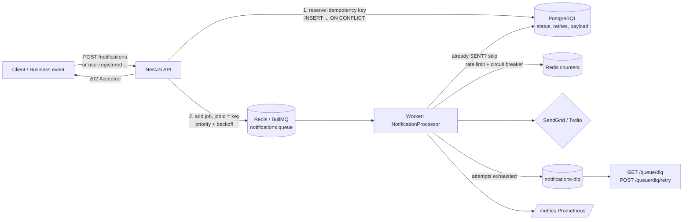

# Event-Driven Notification Platform

Asynchronous email/SMS delivery built to stay correct when providers are slow, down, or rate-limited.
**NestJS · TypeScript · PostgreSQL (Prisma) · Redis · BullMQ · SendGrid · Twilio · Prometheus**

Clients never wait on a provider. The API validates and persists a request, enqueues it, and returns `202 Accepted`.
Workers deliver it with retries, backoff, rate limiting and a dead-letter queue, and every step is recorded in
Postgres and exposed as Prometheus metrics.

## Architecture



## Core features (and the reasoning behind each)

| Feature | How it works | Why it is built this way |
|---|---|---|
| **Async processing** | `POST /notifications` and `/welcome-email` enqueue and return `202`. BullMQ workers deliver. Business events (`user.registered`, `order.placed`, ...) fan out into queued jobs via `@OnEvent` listeners. | Provider latency and outages must never block or fail the caller. OTP send/verify stays synchronous because it is an interactive flow that needs the provider's immediate result. |
| **Idempotent producer and consumer** | Idempotency key = client-supplied, or derived (business-event id + channel; or a content hash within a 1-minute window). It is a **unique column in Postgres** and also the **BullMQ jobId**. The worker checks persisted status and skips jobs already `SENT`. | Retries, double-clicks, re-emitted events and a worker crashing after sending but before acking all happen in practice. The guarantee lives in Postgres so it survives a Redis flush. |
| **Retry, exponential backoff, DLQ** | 5 attempts, backoff 1s/2s/4s/8s. After the last failure the job is copied to `notifications-dlq` and the row is marked `DEAD_LETTER` with the last error. `POST /queue/dlq/retry` replays it with a fresh budget. | Transient failures heal themselves. Permanent ones are kept, visible and replayable instead of silently lost. |
| **Priority queues** | OTP = 1, event-driven = 2, welcome = 3 (lower number runs first, BullMQ semantics). | A late OTP is useless, so it must not wait behind bulk traffic. |
| **Provider rate limiting** | Fixed-window counter per provider in Redis (`INCR` + `EXPIRE`, atomic). Exceeding it throws, so the job retries later via backoff. Limits are configurable per provider. | Stay under SendGrid/Twilio quotas. State is in Redis, so the limit holds across multiple worker processes. |
| **Circuit breaker** | CLOSED, OPEN, HALF_OPEN around each provider call. | Stop hammering a provider that is down and let it recover. |
| **Monitoring** | `GET /metrics` (Prometheus): attempts by outcome, job duration histogram, dead-lettered total, rate-limit rejections, circuit-open count, live queue depth per state. Plus `GET /queue/stats` and `GET /queue/jobs/:id`. | You cannot operate what you cannot see. |

## Run it

```bash
cp .env.example .env            # fill SendGrid/Twilio values (fake ones are fine to explore retries/DLQ)
docker compose up -d            # PostgreSQL + Redis
pnpm install                    # postinstall runs `prisma generate`
pnpm db:migrate                 # applies migrations incl. the reliability columns
pnpm start:dev                  # API + workers, Swagger at http://localhost:5050/docs
pnpm test                       # unit tests
```

Try it:

```bash
# queue an email (repeat it: the second call returns "Duplicate request suppressed")
curl -X POST localhost:5050/notifications -H 'content-type: application/json' -d '{
  "userId":"123e4567-e89b-12d3-a456-426614174000","channel":"EMAIL","type":"INFO",
  "title":"Hi","message":"hello","email":"you@example.com","idempotencyKey":"demo-1"}'

curl localhost:5050/queue/stats      # queue depth
curl localhost:5050/queue/dlq        # dead-lettered notifications
curl localhost:5050/metrics          # Prometheus metrics
```

With invalid provider credentials you can watch a job retry with backoff and land in the DLQ.

## API summary

| Method | Path | Purpose |
|---|---|---|
| POST | `/notifications` | Queue an email/SMS (`202`) |
| POST | `/notifications/welcome-email` | Queue a welcome email (one per user and email) |
| POST | `/notifications/verification-code`, `/verify-code` | Synchronous OTP flow |
| POST | `/business-events/...` | Emit a business event that fans out to notification jobs |
| GET | `/queue/stats`, `/queue/jobs/:id` | Queue depth, job state |
| GET | `/queue/dlq` | List dead-lettered notifications |
| POST | `/queue/dlq/retry` | Replay one (`{"idempotencyKey": "..."}`) |
| GET | `/metrics` | Prometheus scrape endpoint |

## Notification lifecycle (Postgres)

`PENDING` then `PROCESSING` then `SENT`, or `FAILED` (will retry) then `DEAD_LETTER` (retries exhausted, replayable).
The row stores the idempotency key, retry count, last error, provider and the original payload (so DLQ replay needs no resubmission).

## Design decisions and trade-offs (good interview material)

- **BullMQ on Redis, not RabbitMQ.** Same pattern (durable queue, competing consumers, retries, priorities, delayed jobs) with less infrastructure, and Redis is already needed for rate limiting. RabbitMQ would be preferable for complex routing or cross-language consumers.
- **At-least-once delivery plus idempotent consumers** gives effectively-once sends. Exactly-once across a network is not achievable. If a worker crashes between the provider accepting a message and Postgres being updated, a duplicate send is still possible. A provider-side idempotency key would close that last gap.
- **Fixed-window rate limiter** is simple and atomic but allows up to 2x bursts at window boundaries. A sliding window or token bucket is smoother at higher cost.
- **Raw SQL for the reliability columns** (`ON CONFLICT DO NOTHING`) gives an atomic reserve-or-detect-duplicate in one round trip.
- **Validation errors are retried** like any other failure. Marking them non-retryable (BullMQ `UnrecoverableError`) is a known improvement.

## Bugs found and fixed in the original code base

- The business-event listener was never subscribed to any event, and the queue processor lacked `@Processor`, so the queue never ran.
- `AbstractNotifier` declared `@Inject` on constructor parameter 0; Nest merged that into subclasses, so the provider was silently replaced by the logger and every send crashed.
- `CacheInterceptor` keyed responses by handler name and cached POSTs, so within the TTL every request returned the first caller's response and sent nothing.
- The circuit breaker and rate limiter were stubs and not registered in any module.
- The committed Prisma client was Windows-only; it is now generated per platform (`postinstall`, `binaryTargets`).
- Phone validation accepted values like `123`.

## Known limitations

- `test/` (e2e/integration specs) predates the async redesign and was not updated; run `pnpm test` for the unit tests.
- Provider calls were exercised against unreachable endpoints (retries, DLQ, rate limiting), not against live SendGrid/Twilio accounts.
- Single Redis instance; no Redis Sentinel/Cluster setup.
